

  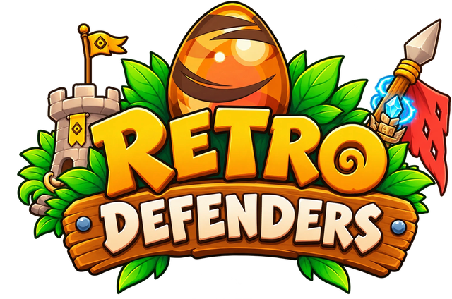

  <b>A tower defense game set in the world of Dofus Retro.</b> 
  The twelve classes are your towers, the monsters come from their real regions, 
  and every upgrade changes your character's outfit.

  
  
  

  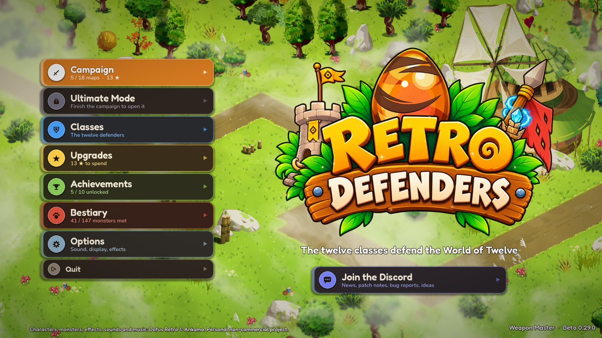

---

## ✨ Features

- **12 classes, 12 towers.** Cra, Feca, Osamodas, Enutrof, Sram, Xelor, Ecaflip, Eniripsa, Iop, Sadida, Sacrier and Pandawa, each with their own spells, two evolution paths and outfits that change as they level up.
- **An 18-map campaign** across Amakna, Astrub, Sidimote, Pandala and beyond, from Astrub Fields to Ilyzaelle's Lookout, with a difficulty curve that rises map after map.
- **147 monsters** from the original game, each with its own resistances, bosses that charge through your lines, and summoners.
- **12 heroes** to send around the battlefield, each with a special spell and points to spend as they level up.
- **44 items** dropped in battle that boost your towers, plus a star upgrade tree and achievements.
- **Ultimate Mode:** endless stages generated from a seed, with new maps, terrain and waves every stage, and optional challenges for a higher score.
- **Tactical pause:** stop time to build, upgrade, move your hero and line up your spells.
- **Map interactions:** fell a tree across the path, roll logs, call the tide and more.
- **Plays your way:** mouse and keyboard, full gamepad support, or touch.
- **5 languages:** English, French, Spanish, German and Portuguese.

## 🖼️ Screenshots

<table>
  <tr>
    <td>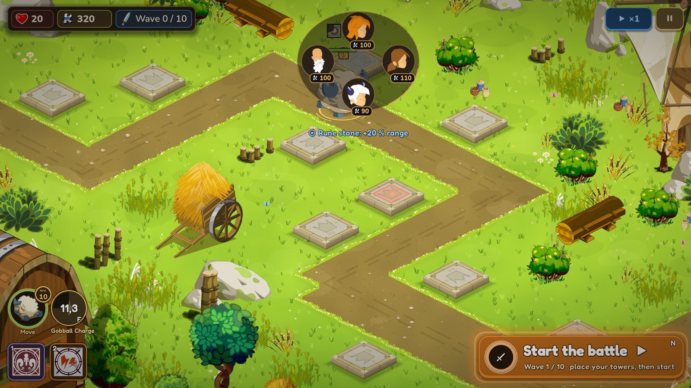</td>
    <td>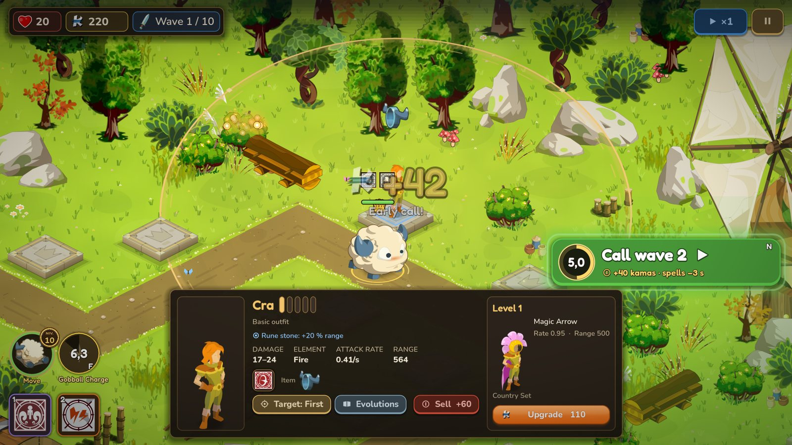</td>
  </tr>
  <tr>
    <td align="center">Pick a class for each slab</td>
    <td align="center">Upgrade, retarget and equip your towers</td>
  </tr>
  <tr>
    <td>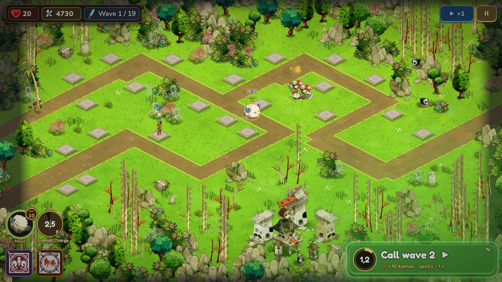</td>
    <td>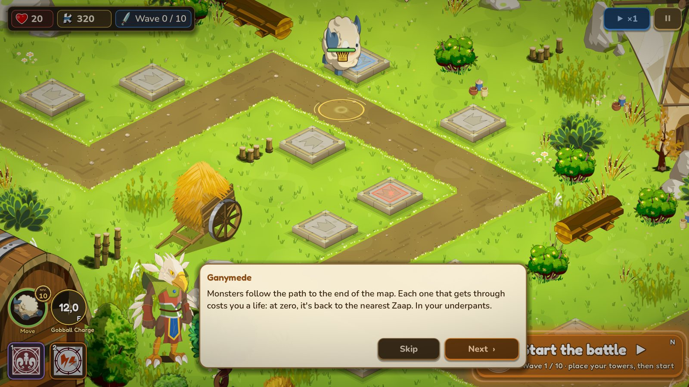</td>
  </tr>
  <tr>
    <td align="center">Pandala Forest</td>
    <td align="center">Ganymede shows newcomers the ropes</td>
  </tr>
  <tr>
    <td>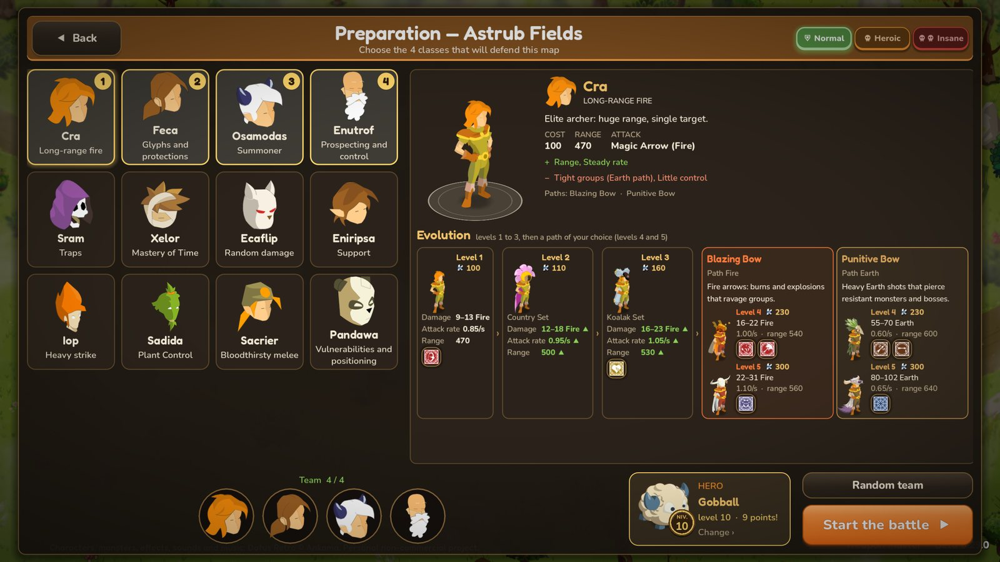</td>
    <td>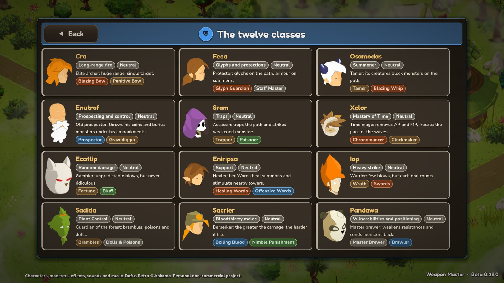</td>
  </tr>
  <tr>
    <td align="center">Prepare your team before each battle</td>
    <td align="center">The twelve classes</td>
  </tr>
  <tr>
    <td>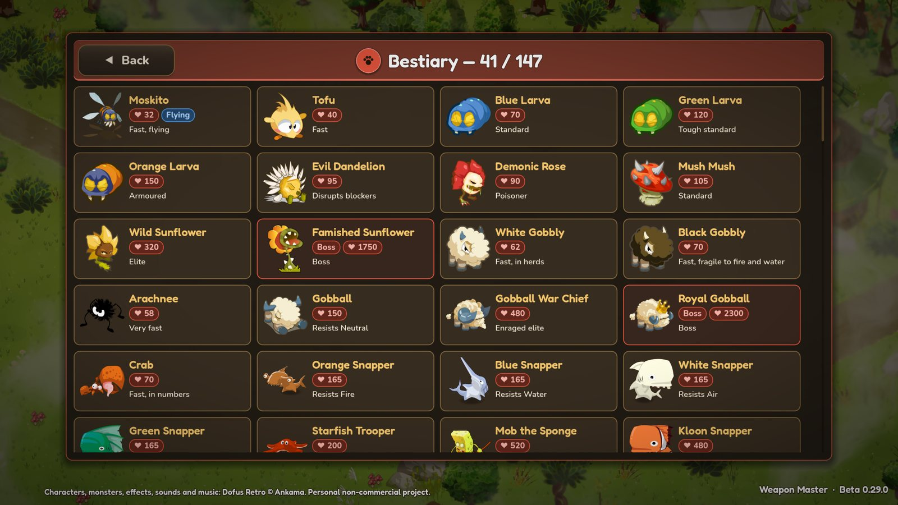</td>
    <td>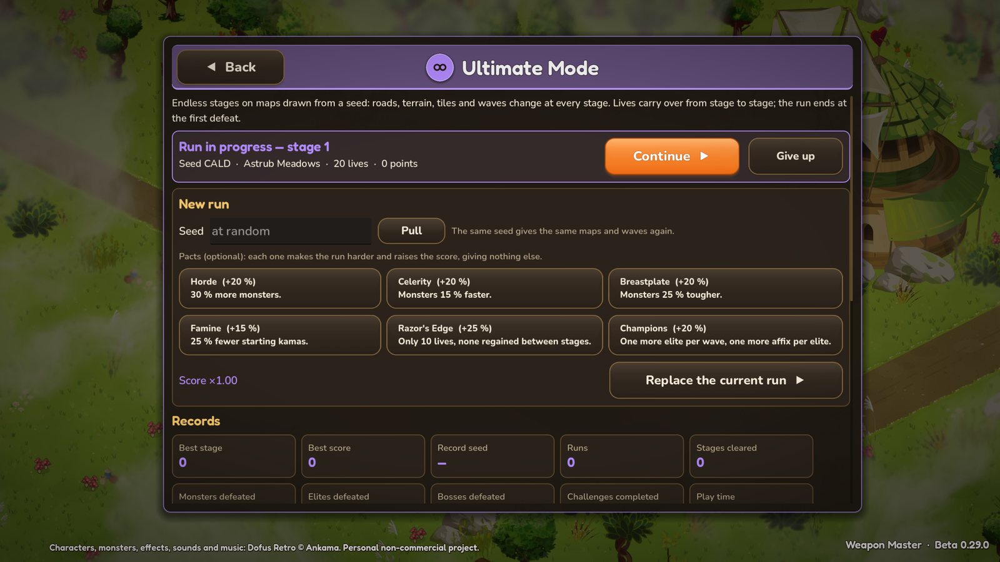</td>
  </tr>
  <tr>
    <td align="center">Bestiary</td>
    <td align="center">Ultimate Mode</td>
  </tr>
</table>

### The campaign

  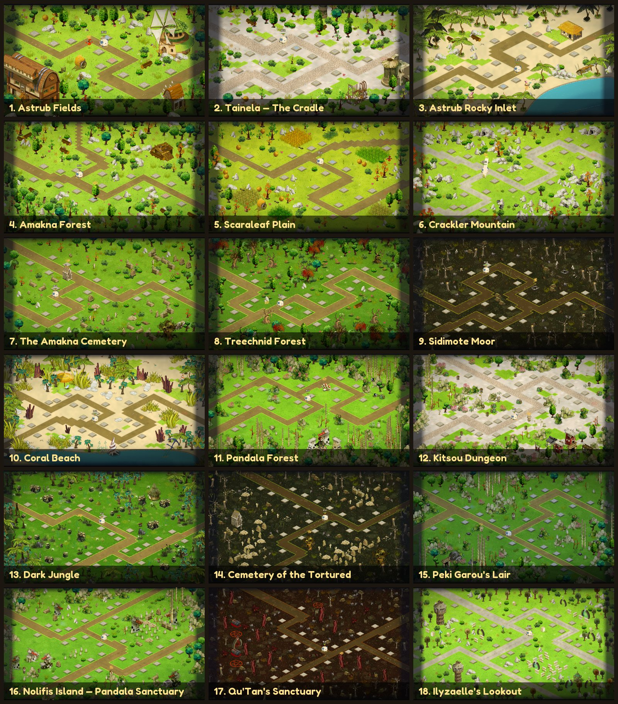

## ⬇️ Download and install (Windows)

1. Go to the **[latest release](https://github.com/BigFatDeuce/retro-defenders-game/releases/latest)**.
2. Download **`RetroDefenders-<version>-windows.zip`** and unzip it into a folder.
3. Run **`RetroDefenders.exe`**. Keep the `data` folder next to it.
4. *4K screen?* Also download **`RetroDefenders-<version>-pack-4K.zip`** and unzip it into the same folder. It adds sharper sprites for 4K displays. Without it, the game uses the sprites made for 1080p and 1440p screens.

> [!NOTE]
> The game isn't code-signed, so Windows SmartScreen may show a warning the first time. Click **More info → Run anyway**.

**Requirements:** Windows 10 or 11 (64-bit), a graphics card supporting OpenGL 3.3 and BC7 textures (most cards from the last ten years), and 3.2 GB of disk space (4.3 GB with the 4K pack).

## 🎮 Controls

| Action | Mouse & keyboard | Gamepad |
|---|---|---|
| Build, select, upgrade | Left click | A |
| Cancel | Right click | B |
| Move the camera | Right-drag, or W A S D / arrow keys | Right stick |
| Zoom | Mouse wheel, `+` / `-` | LT / RT |
| Start the battle / call the next wave | `N` | X |
| Player spells | `1`, `2` | LB, RB |
| Hero's special spell | `F` or `3` | Y |
| Send the hero | `H` | L3 |
| Change speed | `Space` | Select |
| Menu | `Esc` | Start |

On a touch screen, tap to act, drag one finger to move the camera, pinch to zoom, and slide your finger to aim a spell (it's cast when you lift your finger).

## 📜 About

Retro Defenders is a non-commercial fan project and is not affiliated with or endorsed by Ankama. Dofus and Dofus Retro are trademarks of Ankama. The characters, monsters, effects, sounds and music shown in the game come from Dofus Retro and belong to Ankama.

Made with [Godot Engine](https://godotengine.org).
